# rich-struct

Pretty, themed output for Python, built on [`rich`](https://github.com/Textualize/rich). You get rich's `print` with 25 colour themes (23 from popular editors, two of our own) and one-call helpers for Markdown, HTML, JSON, YAML, XML, code, Python objects and tables: lists, numpy arrays, pandas DataFrames and Series. There's also coloured [`structlog`](https://www.structlog.org) logging in the same themes.

It works in a plain terminal and looks best in Jupyter notebooks, VS Code's in particular.

> **Note:** rich-struct is an independent wrapper around `rich`. It isn't part of the [Textualize/rich](https://github.com/Textualize/rich) project, and that project doesn't endorse it.

## Install

You need Python 3.9 or newer. The only required dependency is `rich` 13+.

```sh
pip install rich-struct
```

Some features need an extra:

| Extra | Adds | Needed for |
|---|---|---|
| `yaml` | `pyyaml` | `print_yaml` with an object, or with `max_list_length` (a plain YAML string works without it) |
| `html` | `markdownify` | `print_html` |
| `log` | `structlog` 22+ | `rich_struct.log` |

```sh
pip install "rich-struct[yaml,html,log]"    # all of them
```

numpy and pandas aren't dependencies. If you have them installed, rich-struct prints them as tables.

## Quick start

```python
from rich.markdown import Markdown
from rich.theme import Theme
from rich_struct import (
    ThemeName, print, print_err, print_html, print_json, print_list, print_md,
    print_obj, print_syntax, print_table, print_xml, print_yaml, set_default_theme,
)

print("[bold]hello[/bold]", {"a": 1})                 # works like rich.print, in Midnight Slate by default
print(Markdown("## Printing structs"), theme=ThemeName.DRACULA)

print_md("# Title\n\n```python\nprint('hi')\n```")
print_json({"a": [1, 2, None]}, theme="Nord")         # a theme's name as a string works too
print_yaml("a: 1\nb: [x, y]")
print_xml("<a><b c='d'/></a>")                        # or an ElementTree element, which gets indented
print_html("<h1>Title</h1><p>Some <b>bold</b> text</p>")  # renders the page instead of showing its tags
print_obj(my_dataclass, theme=ThemeName.GITHUB_LIGHT)
print_obj(data, max_list_length=10, max_string=80)    # long containers and strings end in "... +N"
print_obj(doc, apply_newlines=True)                   # a "\n" inside a string starts a new line
print_json(data, max_list_length=10)                  # print_yaml takes max_list_length too
print_syntax("SELECT 1", "sql")                       # any pygments lexer
print_table(df, title="Sales")                        # DataFrame, Series, numpy array, list...
print(df)                                             # print turns arrays and frames into tables too
print_err(ValueError("bad input"))                    # error text or an exception, in the theme's error colour
print_list(series, head_tail_only=True)               # [1, 2.5, 'text',  ...  98, 99]

print_md("# Mine", theme=Theme({"markdown.h1": "bold magenta", "syntax.keyword": "red"}))
set_default_theme("Dracula")                          # every call from now on uses Dracula
```

## Choosing a theme

Every function takes `theme=`, which can be a `ThemeName`, its string value (`"Nord"`), or your own rich `Theme`. To change the theme everywhere at once, call `set_default_theme("Dracula")`. It accepts the same values, and calling it with no argument goes back to Midnight Slate.

In a VS Code notebook the default theme follows VS Code's colour theme (`workbench.colorTheme` in your user settings): you get Paper Frost with a light VS Code theme and Midnight Slate with a dark one. This only works when the kernel runs on the same machine as VS Code. Otherwise the default is Midnight Slate.

If you want a theme for your own `Console`, `ThemeName.X.theme` gives you the underlying rich `Theme`.

Paper Frost colours JSON, YAML and XML the way its VS Code theme does: muted punctuation, numbers and booleans set apart, and namespaces and anchors in their own colours. It also highlights Jinja tags (`{{ }}`, ``) in italic greens, inside YAML, XML, HTML, JSON strings and Python strings (f-strings excepted). This applies everywhere these formats are printed: `print_json`, `print_yaml`, `print_xml`, `print_syntax` and Markdown code blocks.

## Notebooks

In a notebook, each `print_*` output sits in its own box: rounded corners, a little padding and a 1px border. Light themes draw the border in their own blue (Paper Frost `#0369a1`), and dark themes in a colour between the background and the text. A custom `Theme` can set it with a `frame.border` style. That keeps it separate from the rest of the notebook, even when the notebook uses the same theme. Log blocks look the same and also have an accent bar on the left.

VS Code notebooks show rich's output in rich's own monospace font (Menlo, DejaVu Sans Mono...). Call `use_rich_font_override(True)` to use the font that plain `print()` gets, and `False` to switch back. Lines stay closer together than in `print()` output on purpose. VS Code gives `print()` a looser line height, but rich keeps `line-height:normal` so that table and panel borders join into solid lines, and copying `print()`'s spacing would leave gaps in them.

## A few things that hold for every function

- Passing `None` prints `None` (`null` for JSON) in the theme's colour for null values. Nothing raises.
- In a notebook, output is painted on the theme's background across the full width. In a terminal it keeps the terminal's own background. Pass `background=True` or `False` to one call, or call `use_background(True/False)` to change the default; `use_background(None)` brings back the automatic choice.
- Output without colour, such as output piped to a file, gets no background or padding.
- Other keyword arguments (`style=`, `justify=`, ...) go through to rich's `Console.print`.

## Screenshots

Each kind of struct is shown in a different theme, as it looks in a notebook cell. The [demo notebook](https://github.com/wiertmir/rich-struct/blob/main/demos.ipynb) has every kind in all 25 themes; open it in Jupyter or VS Code to see the colours.

Markdown with `print_md`, in Midnight Slate (the default):

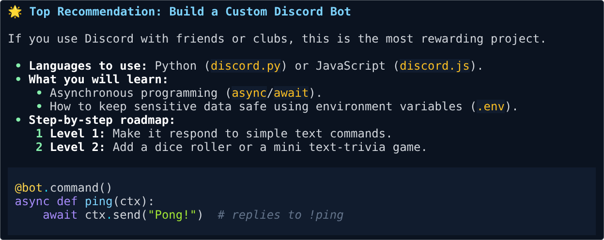

HTML with `print_html`, in Dracula:

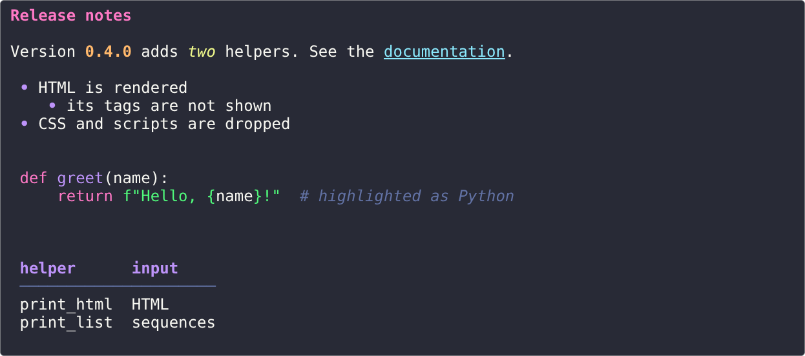

JSON with `print_json`, in Nord:

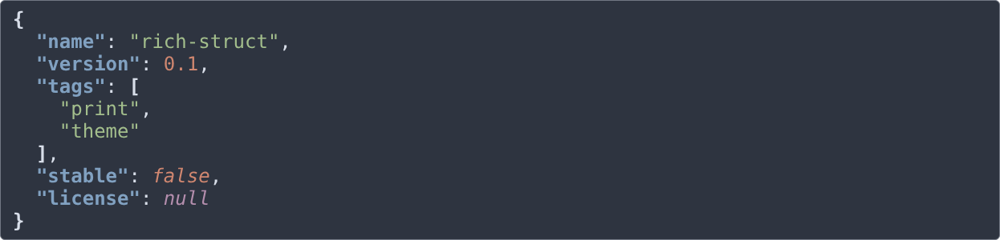

YAML with `print_yaml`, in One Dark Pro:

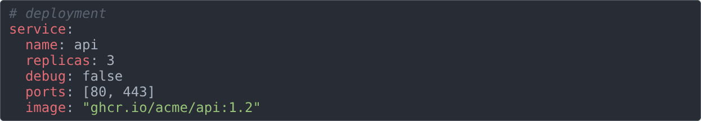

XML with `print_xml`, in GitHub Dark:

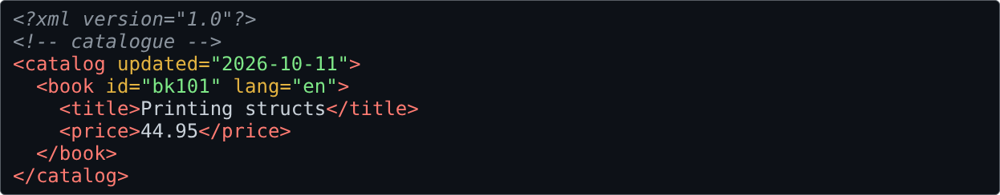

Python objects with `print_obj`, in Catppuccin Mocha:

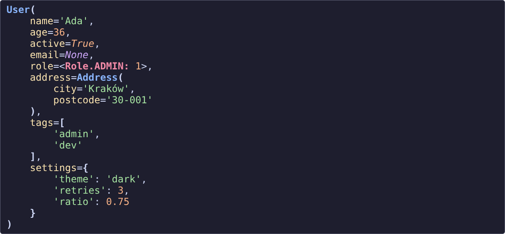

Code with `print_syntax`, in One Light:

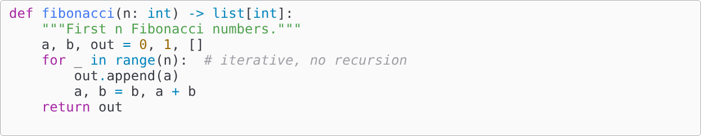

Lists with `print_table`, in Catppuccin Latte:

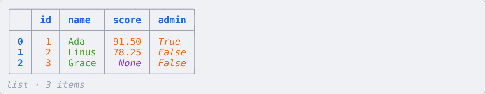

A sequence with `print_list` and `head_tail_only`, in Tokyo Night:

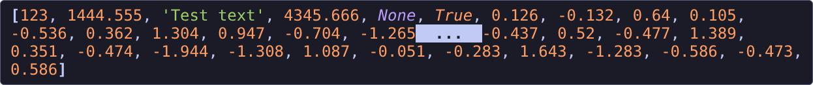

NumPy arrays with `print_table`, in Solarized Dark:

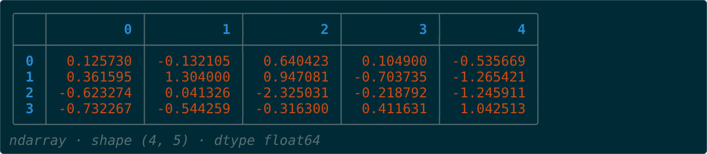

pandas DataFrames with `print_table`, in GitHub Light:

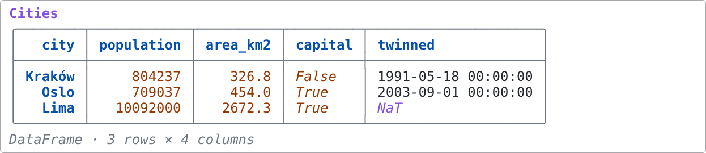

pandas Series with `print_table`, in Night Owl:

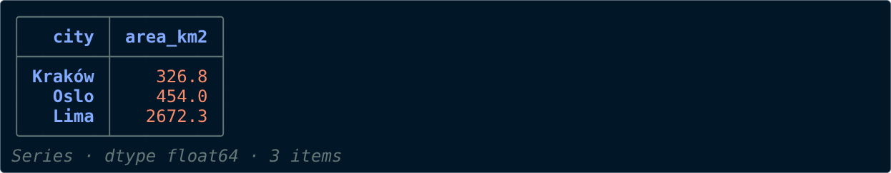

## Tables

`print_table(data, title=None, max_rows=20, max_cols=10)` accepts:

- pandas `DataFrame` and `Series`, and numpy arrays of any dimension (with more than two dimensions you get one table per slice)
- lists of dicts (one row per dict), lists of lists (a grid), and any other sequence, such as `array.array` or `range`, as a single column

Numbers are right-aligned, floats in a column line up on the same number of decimals, and missing values are dimmed. Long data shows its first and last rows with a `…` gap between them. Columns that don't fit the terminal width go into the gap too.

Use `to_table(data)` to get the rich renderable without printing it.

## Lists

`print_list(data, wrap=True, head_tail_only=False, head_tail_size=100)` prints a list, tuple, `array.array`, numpy array or pandas `Series` on one line, like `[123, 1444.555, 'Test text', 4345.666]`.

Long lists wrap at the terminal width, unless you pass `wrap=False`. With `head_tail_only=True` you see only the first and last `head_tail_size` items, with a highlighted `  ...  ` between them.

## Logging

`rich_struct.log` gives you coloured console logging, and daily log files if you want them, on top of [`structlog`](https://www.structlog.org). Install it with `pip install "rich-struct[log]"`. The rest of rich-struct works without it.

```python
from rich_struct.log import get_logger

log = get_logger()                                        # console only, no setup needed
log.info("Processed %s in %03d ms.", position, elapsed)   # printf style...
log.info("Processed {} in {:03d} ms.", position, elapsed) # ...or str.format style
log.info("Saved", user="bob", retries=3)                  # extra fields as key=value
log.exception("Caught {!r}", err)                         # adds the traceback

job_log = log.bind(job="nightly")                         # every line from job_log carries job=nightly
job_log.info("Started")                                   # unbind("job") and new(...) work as in structlog
```

```
12:33:30.238 INFO     Processed A-17 in 042 ms.
12:33:30.239 ERROR    Caught ZeroDivisionError('division by zero')
```

On the console, the level name is coloured by level (errors get the brightest red) and each argument by its type: text, numbers, `True`/`False`, `None`, paths, exceptions and everything else. The colours come from the theme, and nothing is bold.

A `datetime` argument or field without a format spec is shown to the millisecond with its own UTC offset, like `2026-10-29 12:33:30.238+09:00`. It isn't converted to local time, so you can see which zone it came from.

If a message doesn't match its arguments, the line is still logged with the arguments added at the end. Logging never raises.

In Jupyter notebooks (VS Code or JupyterLab), consecutive log lines share one block that grows while the cell runs, in the theme's background with a border and an accent bar. Without this you'd get a separate output per line with gaps between them. Any other output in between, such as a `print` or a plot, closes the block, so the logs stay in order with everything else.

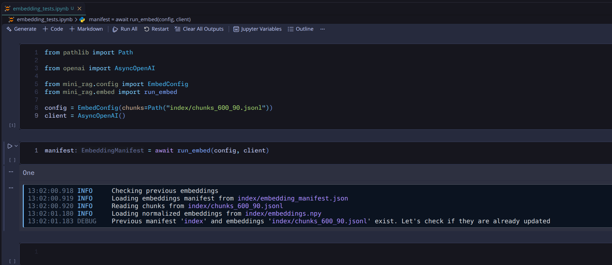

### Configuring

`configure()` is optional. It changes the defaults, and you need to call it before the first `get_logger()`:

```python
from rich_struct.log import configure

configure(level="info")                  # debug (default), info, warning, error or critical
configure(theme="Dracula")               # any rich-struct theme; defaults to the one from set_default_theme()
configure(message="tint")                # colour of the message text, see below
configure(console=False)                 # no console output
configure(thread=True)                   # thread name on every line (default: only on free-threaded Python)
configure(file=True)                     # also write logs/<script name>_yyyy_mm_dd.log
configure(file="var/log", keep=14)       # use another folder and keep 14 days
configure(handler=my_handler)            # send every line to any logging.Handler as well
```

`message=` sets the colour of the message text. `"plain"` (the default) uses the theme's text colour, `"level"` uses the level's colour, and `"tint"` mixes a little of the level's colour into the text colour. Fields keep their own colours in all three.

With `file=True`, the file gets the same lines without colours. Each line starts with the local date, time and UTC offset, and names the module (and the class, when the call is inside a method) that logged it:

```
2026-10-29 12:33:30.238+09:00 INFO     `__main__.Job` Processed A-17 in 042 ms.
```

A new file starts at local midnight, and only the newest `keep` files (7 by default) are kept. The handler behind this is `DailyFileHandler`, which you can also use on its own.

On free-threaded Python, both the console and the file show the thread name, like `[worker-1]`, after the level. `thread=True` or `False` turns it on or off anywhere.

`configure()` calls `structlog.configure()`, so it affects every structlog logger in the process. [`examples/log_demo.py`](https://github.com/wiertmir/rich-struct/blob/main/examples/log_demo.py) shows all of it in one script.

## Themes

| Dark | Light |
|---|---|
| Tokyo Night | GitHub Light |
| Dracula | Solarized Light |
| One Dark Pro | One Light |
| Monokai | Catppuccin Latte |
| Nord | Gruvbox Light |
| Gruvbox Dark | Tokyo Night Light |
| Catppuccin Mocha | Ayu Light |
| Solarized Dark | Night Owl Light |
| GitHub Dark | Light+ |
| Night Owl | Everforest Light |
| Winter is Coming | Light Modern |
| Dark Modern | Paper Frost (default under a light VS Code theme) |
| Midnight Slate (default) | |

Midnight Slate and Paper Frost are rich-struct's own. The others take their colours from each editor theme's palette, so they look close to the original, though a given token may not get the exact colour your editor gives it.

### Making your own

Any rich `Theme` works. These styles have a special meaning:

- `background` paints the output's background, e.g. `"background": "#c0caf5 on #1a1b26"`. Without it, a custom theme gets no background.
- `syntax.*` styles colour code: `text`, `comment`, `keyword`, `string`, `number`, `function`, `type`, `tag`, `attribute` and `operator`. You can override any of them.
- `syntax.block` (e.g. `"on #111c2e"`) shades code blocks inside Markdown.
- `repr.background` gives `print_obj` output its own background.

## License

MIT. See [LICENSE](LICENSE).
